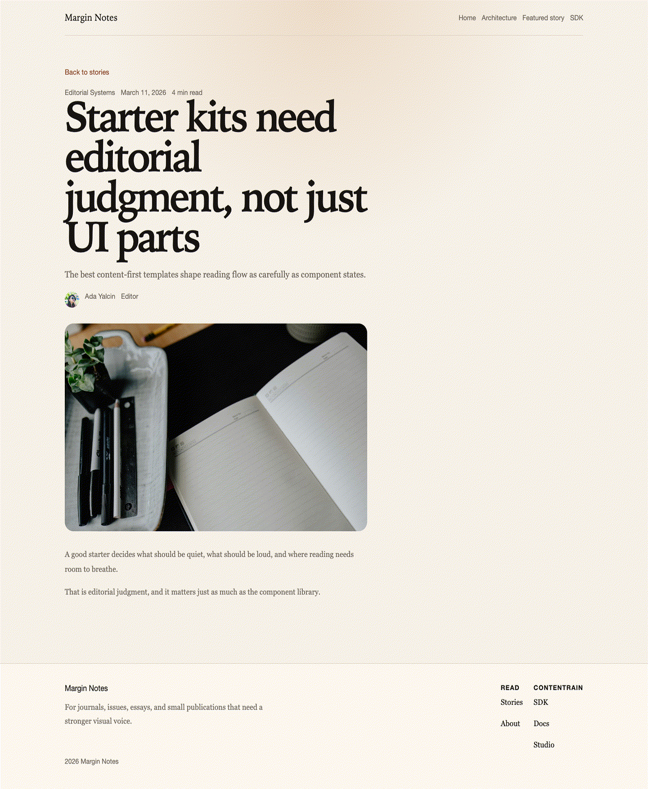

<p align="center"></p>

# Contentrain SvelteKit Editorial

An editorial starter for journals, essays, and small publications, built with SvelteKit and content managed by [Contentrain](https://ai.contentrain.io), the content governance ecosystem for teams and AI agents.



## What it shows

- Stories, authors, and categories as Contentrain models, with relations resolved at build time (`include("author", "categories")`).
- Site settings, navigation, footer, and SEO defaults as singletons, read in the root layout.
- Server `load` functions reading the generated `#contentrain` client, the setup the [SvelteKit guide](https://ai.contentrain.io/guides/frameworks#sveltekit) documents.
- A fully prerendered static site (`@sveltejs/adapter-static`), with no runtime content fetches.
- An `/architecture` page that lists the models in `.contentrain/models`.

Routes: `/`, `/stories/[slug]` (one page per story), `/architecture`.

## Use this template

1. Click **Use this template** on GitHub to create your own repository.
2. Optional: connect the new repository in [Contentrain Studio](https://contentrain.io/studio). The repository already contains `.contentrain/`, so Studio opens it as a project. Edits made in Studio are committed to the `contentrain` branch of your repository.

## Quick start

Node 22 and pnpm are required.

```bash
pnpm install
pnpm dev
```

| Command | What it does |
|---|---|
| `pnpm dev` | Start the dev server |
| `pnpm check` | Type-check with `svelte-check` |
| `pnpm build` | Build the static site into `build/` |
| `pnpm preview` | Serve the built site |
| `pnpm contentrain:generate` | Regenerate the typed client in `.contentrain/client/` |
| `pnpm contentrain:validate` | Validate models and content in `.contentrain/` |

After you change anything in `.contentrain/models` or `.contentrain/content`, run `pnpm contentrain:generate`.

## Content model

| Model | Kind | Domain | Fields |
|---|---|---|---|
| `blog-post` | document | editorial | `title`, `slug`, `excerpt`, `cover_image`, `published_at`, `reading_time`, `author` → `author`, `categories` → `blog-category`, Markdown body |
| `author` | collection | editorial | `name`, `role`, `bio`, `avatar`, `social_url` |
| `blog-category` | collection | editorial | `name`, `slug`, `summary` |
| `site-settings` | singleton | system | `site_name`, `site_tagline`, `default_locale`, `theme_name`, `og_image` |
| `navigation` | singleton | system | `items`, `cta_label`, `cta_href`, `announcement_label` |
| `footer` | singleton | system | `blurb`, `columns`, `legal_notice` |
| `seo-defaults` | singleton | system | `meta_title`, `meta_description`, `canonical_base`, `og_image` |

Content is in English (`en`), with one file per locale under `.contentrain/content/`.

## Deploy

The build output is a static site in `build/`. `netlify.toml` is included: build command `pnpm deploy:netlify`, publish directory `build`, Node 22. See [USAGE.md](./USAGE.md) for Netlify CLI steps.

[](https://app.netlify.com/start/deploy?repository=https%3A%2F%2Fgithub.com%2FContentrain%2Fcontentrain-starter-sveltekit-editorial)

## Contentrain

Contentrain has four parts: the open-source tools, Studio, Migrate and Bridge.

- SDK, CLI, and MCP docs: [ai.contentrain.io](https://ai.contentrain.io)
- Query SDK: [ai.contentrain.io/packages/sdk](https://ai.contentrain.io/packages/sdk)
- Contentrain Studio: [contentrain.io/studio](https://contentrain.io/studio)
- Open-source tools (MIT): [github.com/Contentrain/ai](https://github.com/Contentrain/ai)
- Migrate, WordPress to Astro: [migrate.contentrain.io](https://migrate.contentrain.io)
- Bridge, a free WordPress plugin that exports content as a Contentrain store: [github.com/Contentrain/wordpress-bridge](https://github.com/Contentrain/wordpress-bridge)

## License

[MIT](./LICENSE)
